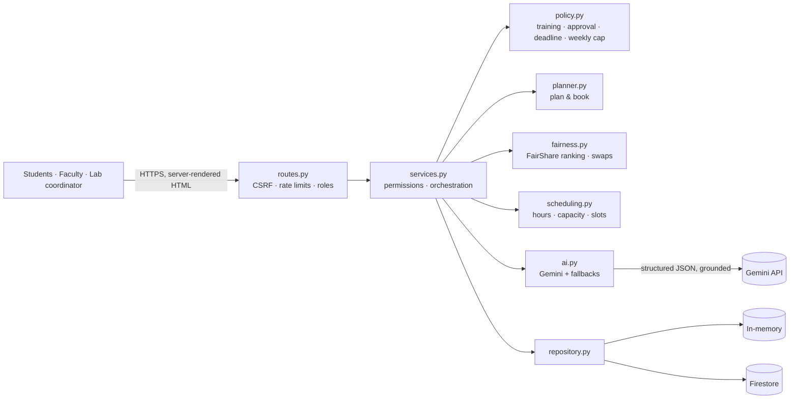

# LabLink: Making College Laboratories More Accessible

**Live app:** https://lablink-oiz3.onrender.com · **Code:** https://github.com/Alchemist-47/LabLink

LabLink is a GenAI-powered platform for sharing lab resources across a campus. Students describe what they need to do and find specialised equipment, development kits and workstations in **any** department. They request access for a project, and LabLink plans and books their sessions. Faculty approve requests with an AI brief. When too many teams want the same machine, a **transparent, deadline-aware fairness engine** resolves the clash, sometimes by proposing a swap, and Gemini explains every outcome in plain language.

## Evaluation criteria at a glance

| Criterion | Evidence (where to look) |
|---|---|
| **Code quality** | Layered `routes → services → pure domain modules` ([`lablink/`](lablink)); domain rules have no I/O ([`policy.py`](lablink/policy.py), [`planner.py`](lablink/planner.py), [`fairness.py`](lablink/fairness.py), [`scheduling.py`](lablink/scheduling.py)). **Enforced in CI:** ruff lint incl. **cyclomatic complexity ≤ 12 for every function** and the bandit security rules, **mypy** type checking ([`pyproject.toml`](pyproject.toml)). Average complexity 3.3; docstrings on the public API. Storage behind one interface with two implementations. |
| **Security** | [`SECURITY.md`](SECURITY.md): CSRF on every form, strict CSP and security headers, server-side role and ownership checks, input validation and size limits, rate limits, prompt-injection handling, atomic booking, non-root container, `pip-audit` in CI. Tested in [`tests/test_security.py`](tests/test_security.py). |
| **Efficiency** | **p50 1.2 ms, p95 2 ms, about 800 requests/s per worker, 2.3 MB peak heap** over 2,000 mixed requests ([`scripts/benchmark.py`](scripts/benchmark.py)). Gemini responses cached and rate-limited; faculty briefs generated once and stored. No JavaScript, self-hosted fonts, four runtime dependencies. |
| **Testing** | **225 tests, 97% coverage, CI fails below 90%** ([`.github/workflows/tests.yml`](.github/workflows/tests.yml)). Fairness, planner, rules, AI fallbacks with a fake Gemini, permissions, security, the same contract tests on both storage back ends, and edge cases found by fuzzing every route (about 15,000 hostile requests, zero server errors). |
| **Accessibility** | Zero axe-core violations (WCAG 2.1 AA + best practice) on every page and role, desktop and mobile. **42 automated tests** ([`tests/test_accessibility.py`](tests/test_accessibility.py)) check every page for language, headings, landmarks, skip link, labels, names, tables and the contrast of every design colour pair. Keyboard-only, works without JavaScript. |
| **Problem alignment** | Every clause of the brief maps to a working feature: see [How it covers the challenge](#how-it-covers-the-challenge). |

## Chosen vertical

**Campus laboratory resource sharing**, for the challenge *LabLink: Making College Laboratories More Accessible*. There are three personas:
- **Students:** discover, plan and book equipment for their projects.
- **Faculty guides:** approve project access for their students.
- **The lab coordinator:** resolves conflicts and watches utilisation.

## How LabLink meets the challenge expectations

| Expectation | Evidence in LabLink |
|---|---|
| **A smart, dynamic assistant** | Students describe a task in plain words and Gemini finds equipment across all departments (`ai.search`). They describe a project once and Gemini proposes the equipment and hours (`ai.suggest_needs`). **Plan & book** (`planner.py`) then turns the project into concrete sessions and books them all in one click. Faculty get an AI **Who / Why / Risk** brief per request. Coordinators get AI explanations of every allocation and AI usage tips. Everything reacts to live data: availability, the waitlist, approvals, training records and weekly hours. |
| **Logical decision making based on user context** | Every booking passes the same rules (`policy.py`), using the student's **training records**, **project approval** (only for high-demand equipment), **project deadline**, **other bookings** and **hours already used this week** (12-hour fair-use cap). Conflicts are ranked by **deadline urgency, project type (capstone > club > coursework), recent usage and waiting time** (`fairness.py`). The same request from two students can get different, explained outcomes. Faculty can only decide requests they guide; only the coordinator allocates. |
| **Practical, real-world usability** | Requests never dead-end. A full slot comes with free slots before the deadline, the same kind of machine in another department, or the waitlist; a blocked booking says exactly why (for example "needs Laser Cutter safety training"). Ordinary equipment can be booked as soon as a project exists, and only high-demand machines wait for approval. Students always see their **lab hours this week**, and can **add any booking to their calendar** (`.ics` with a 15-minute reminder). Each machine has a **safety prep checklist**. The app works by keyboard and screen reader, on mobile, and without JavaScript. |
| **Clean, maintainable code** | Layered design: thin routes → services (permissions) → pure domain modules (`policy`, `planner`, `fairness`, `scheduling`) with no I/O. Storage sits behind one interface (memory or Firestore). **225 tests, 97% coverage**, including the same contract tests on both storage back ends and automated accessibility tests. Ruff lint (with a complexity limit of 12 per function), **mypy type checking**, `pip-audit` and the tests run in CI on every push. Four runtime dependencies. |

### What sets it apart
- **Swaps, not just queues.** If every slot before an urgent deadline is taken, FairShare can ask a lower-priority team with a later deadline to move, and only to a slot that still meets *their* deadline.
- **Grounded AI.** Gemini must quote the student's own words for anything it marks as *Needed*, and the code checks the quote. Inferred items are shown separately as *Worth considering*, and pure-software projects are told no lab equipment is needed. The AI never invents equipment and never makes allocation decisions.
- **Honest when AI fails.** Every AI result is labelled as Gemini or keyword matching, or with a notice that Gemini didn't respond. The app keeps working without Gemini.
- **Accessible by design.** Zero axe-core violations (WCAG 2.1 AA plus best practice, *including colour contrast*) on every page and role, on desktop and mobile. Accessibility is also **tested on every push**: 42 tests check labels, headings, landmarks, names, tables and the contrast of every design colour pair.

## How it covers the challenge

| Challenge requirement | What LabLink does |
|---|---|
| Equipment discovery across departments | Plain-language search, e.g. *"measure a 50 MHz signal from my FPGA"*. Gemini matches it against the whole campus catalogue and explains each match, grouping direct matches separately from *also likely useful* ones. Filters by department and type, with live "free now" status. |
| Intelligent slot booking | **Plan & book** proposes the earliest valid sessions for every machine a project needs and books them in one click. Direct booking checks capacity atomically (a Firestore transaction or lock), so the last unit can never be double-booked. Every booking checks training, approval, deadline, clashes with the student's other bookings, and the weekly fair-use cap. |
| Project-based access requests | Describe the project once; Gemini proposes the equipment and hours. One request covers every machine. Ordinary equipment is usable straight away, while high-demand machines wait for the guide's approval. |
| Faculty approvals | Each pending request has an AI **Who / Why / Risk** brief. Only the project's guide (or the lab coordinator) can approve or reject it. |
| Optimising resource utilisation | Usage dashboard (last 14 days, upcoming hours, waitlists) with AI recommendations. The weekly cap stops any one student monopolising equipment, and the planner spreads load onto equivalent machines in other departments. |
| Fair and feasible conflict resolution | **FairShare** (below) gives each team a slot on the requested machine, an equivalent machine elsewhere, or a swap with a lower-priority team. Nothing changes until faculty apply the plan. |

## FairShare: how conflicts are resolved

Waitlisted bookings are ranked by a priority score out of 100:

| Part | Points | Why |
|---|---|---|
| Urgency | 0–40 | The closer the project deadline, the higher the score |
| Project type | 0–20 | Capstone/research > club > routine coursework |
| Fairness | 0–25 | Fewer lab hours used in the last 30 days scores higher, so nobody hogs a machine |
| Waiting | 0–15 | Teams that have been waiting longer score higher |

Teams are placed highest score first, in the first slot before their deadline. LabLink tries, in order:

1. the requested machine (the originally requested time, if it is free);
2. an **equivalent machine** in another department (same category);
3. a **swap**: a team holding a slot before the deadline is asked to move to another slot that still meets *their* deadline. This only happens if that team scores at least 10 points lower and has a later deadline;
4. otherwise, the earliest slot after the deadline, flagged for the guide.

The algorithm is plain, deterministic Python (`lablink/fairness.py`), so the same inputs always give the same outcome, and it is unit-tested. **Gemini does not make allocation decisions.** It only explains them.

The seeded demo has a live conflict: four teams want the Mechanical department's 3D printer, which a coursework team booked early for several days. Switch to *Lab Coordinator* → **Fair allocation** to see all four outcome types, apply the plan, then use **Reset demo** to start again.

## Plan & book: from project to booked sessions

For each machine a project needs, `planner.py` books the remaining hours as sessions of up to 4 hours, each at the earliest time that:
- has a free unit,
- doesn't overlap the student's other bookings,
- keeps the student within **12 hours per week** (later weeks are used if needed),
- ends before the project deadline.

The requested machine is used first. An equivalent machine is used only when the requested one has no room before the deadline, and only one the student is trained for. Items the student can't book yet (approval pending, training missing) are listed with the reason instead of being skipped. **Book all** recomputes the plan on the server and re-checks every session, so a slot taken in the meantime fails cleanly rather than double-booking.

## Architecture



```
lablink/
  routes.py      thin HTTP layer: parse, call service, render
  services.py    business rules and permission checks
  policy.py      booking rules from user context (pure)
  planner.py     plan & book (pure, deterministic)
  fairness.py    FairShare scoring, allocation, swaps (pure, deterministic)
  scheduling.py  opening hours, capacity, slot search (pure)
  ai.py          Gemini calls, grounding checks, keyword/template fallbacks
  validation.py  server-side validation of every input
  security.py    CSRF, security headers, rate limiters, identity header
  repository.py  storage interface + in-memory store;  firestore_repo.py: Firestore
  calendar_export.py  booking → .ics calendar file
scripts/         benchmark.py (speed and memory), eval_ai.py (real-Gemini checks)
tests/           225 tests: domain, services, routes, AI, storage contracts, security, accessibility
```

**Design choices**
- **Decisions are code; Gemini understands and explains.** Rules, planning and allocation are deterministic and tested. Gemini handles language (search, suggestions, briefs, explanations) and is never trusted blindly.
- **Gemini is optional at runtime.** If there's no key, a timeout or a quota error, features fall back to keyword matching or templates and say so. Responses are cached and rate-limited.
- **Lean and accessible.** Server-rendered HTML with no JavaScript, four runtime dependencies, one container.

## Code quality and performance

- **Small functions, enforced.** CI runs ruff with a cyclomatic-complexity limit of 12 per function (average 3.3), the bandit security rules, and mypy. Long decisions are split into named steps; for example, fair allocation reads as *requested machine → equivalent machine → fair swap → defer* (`_Planner.decide` in `fairness.py`).
- **Pure domain logic.** `policy`, `planner`, `fairness` and `scheduling` take data and return decisions, with no database, web or AI calls, so they are fast to test and easy to reason about. Planner and allocation are deterministic.
- **Measured speed** (`python scripts/benchmark.py`, 2,000 mixed requests across all roles with 10% booking attempts, Gemini off, one worker): p50 1.2 ms, p95 2 ms, p99 2.3 ms; about 800 requests/s; 2.3 MB peak Python heap. Fair allocation takes about 0.3 s even with 200 teams waiting for one machine.

## Security

Full details: [`SECURITY.md`](SECURITY.md).

### Security model
- **Demo mode (default, `DEMO_MODE=1`).** There is no sign-in, so judges can try every role from the "Viewing as" switcher. This is deliberate for the demo, and the page header says so.
- **Signed-in mode (`DEMO_MODE=0`).** Deploy behind an identity-aware proxy such as **Google Cloud IAP** (campus Google accounts). The proxy authenticates the user and sets `X-Goog-Authenticated-User-Email`. LabLink matches that email to a user and uses that user's role. Unknown or missing identities get *401 Sign in required*. Role switching and demo reset are disabled, and the user list is never sent to the browser. Only enable this behind a proxy that strips the header from client requests, as IAP does.

### Protections
- **Permissions** are enforced on the server in `services.py`: students book only with their own approved projects; only the project's guide (or the coordinator) decides requests; only faculty and the coordinator allocate; only the coordinator resets the demo. Allocation plans are recomputed on the server when applied, never trusted from the browser.
- **CSRF** tokens on every form. A **strict Content-Security-Policy** (`default-src 'self'`, no inline scripts or styles), HSTS, `X-Frame-Options: DENY`, `nosniff`, and Secure/HttpOnly/SameSite session cookies.
- **Rate limits:** AI features (20 per browser per minute, 120 overall) and every form submission (30 per browser per minute, 300 overall). They are keyed on the signed session, because many users can share one proxy address.
- **Input validation:** length caps, allow-listed IDs, date and hour ranges, a 32 KB request-size limit, and open-redirect protection.
- **AI safety:** student text is passed to Gemini as delimited untrusted data. Every equipment ID Gemini returns is checked against the catalogue, numbers are clamped, and "Needed" suggestions must quote the student's own words.
- **Concurrency:** booking capacity is checked atomically (lock in memory, transaction in Firestore), so the last unit can't be double-booked.
- **No secrets in the repo.** `SECRET_KEY` and `GEMINI_API_KEY` are host environment variables (Secret Manager on Cloud Run), and Firestore uses the service account. The container runs as a non-root user, and error pages don't reveal internals.
- **Dependencies** are pinned and scanned with `pip-audit` in CI.

## Accessibility
- Semantic landmarks, a skip link, one `h1` per page, `aria-current` navigation.
- Every input has a visible label; errors use `role="alert"`, confirmations use `role="status"`.
- Fully keyboard-operable (no JavaScript), clearly visible focus outlines, WCAG AA colour contrast. Status is never conveyed by colour alone (the availability grid shows numbers or "Full").
- Tables use captions and scoped headers; respects `prefers-reduced-motion`; responsive down to mobile.

## Roles (demo)
There's no sign-in for the demo. Use the **Viewing as** switcher in the header:
- **Students:** Ananya, Rahul, Meera, Kiran, Arjun, Neha
- **Faculty:** Prof. Rao, Prof. Iyer, Dr. Khan
- **Admin:** Lab Coordinator

## Run locally

```bash
python -m venv .venv
.venv\Scripts\activate          # Windows  (source .venv/bin/activate on macOS/Linux)
pip install -r requirements-dev.txt
copy .env.example .env          # optional: add GEMINI_API_KEY
flask --app lablink run --debug
```

Without any settings it runs with in-memory demo data and the keyword fallback. To run locally against real Firestore, set `LABLINK_STORAGE=firestore`, `GOOGLE_CLOUD_PROJECT` and `GOOGLE_APPLICATION_CREDENTIALS=serviceAccountKey.json` in `.env`. The key file is git-ignored and excluded from deploy uploads. **Never commit it.**

## Tests

```bash
pytest --cov=lablink          # 225 tests, 97% coverage (fails below 90%)
mypy                          # type check
ruff check lablink tests
```

They cover scheduling, FairShare fairness and swaps, AI fallbacks and prompt-injection handling, permissions, routes, CSRF and headers. **Storage contract tests** run the same checks against both the in-memory store and the Firestore store (using an in-memory fake Firestore client, so no credentials are needed), including atomic capacity under 12 concurrent bookings.

The tests also run on every push via GitHub Actions (`.github/workflows/tests.yml`).

## Deploy (live demo): Render free tier

The repo includes a Render Blueprint (`render.yaml`): a free Docker web service in Singapore with a `/healthz` health check.

1. Sign in at render.com with GitHub. No card is needed for the free tier.
2. **New → Blueprint**, then select this repository. Render reads `render.yaml`.
3. When prompted, paste your **`GEMINI_API_KEY`** (from Google AI Studio). `SECRET_KEY` is generated automatically.
4. Deploy. The app is live at `https://lablink-xxxx.onrender.com`, and every push to `main` redeploys it.
5. **Keep it awake.** Free services sleep after 15 minutes without traffic and take about a minute to wake. Create a free job at cron-job.org that requests `https://<your-app>.onrender.com/healthz` every 10 minutes. One always-on service fits within Render's 750 free hours a month.

On the free tier, storage is in-memory: the demo campus is re-seeded on every restart, which keeps the demo clean for each judge. The page header says so, and the Lab Coordinator has a **Reset demo** button that restores the starting data at any time (for example after applying a fair-allocation plan). The reset works the same with Firestore. For persistent data, set `LABLINK_STORAGE=firestore` on a host with Google Cloud credentials (below).

## Alternative: Google Cloud Run (+ Firestore)

Requires a Google Cloud project with billing enabled.

```bash
PROJECT=your-project-id
REGION=asia-south1
gcloud config set project $PROJECT
gcloud services enable run.googleapis.com firestore.googleapis.com secretmanager.googleapis.com cloudbuild.googleapis.com

# Firestore (Native mode), once per project
gcloud firestore databases create --location=$REGION

# Secrets
python -c "import secrets; print(secrets.token_hex(32))" | gcloud secrets create lablink-secret-key --data-file=-
printf "%s" "YOUR_GEMINI_API_KEY" | gcloud secrets create gemini-api-key --data-file=-

# Let the Cloud Run service account read secrets and use Firestore
SA=$(gcloud projects describe $PROJECT --format='value(projectNumber)')-compute@developer.gserviceaccount.com
gcloud projects add-iam-policy-binding $PROJECT --member=serviceAccount:$SA --role=roles/datastore.user
gcloud projects add-iam-policy-binding $PROJECT --member=serviceAccount:$SA --role=roles/secretmanager.secretAccessor

gcloud run deploy lablink --source . --region $REGION --allow-unauthenticated \
  --set-env-vars LABLINK_STORAGE=firestore,GOOGLE_CLOUD_PROJECT=$PROJECT \
  --set-secrets SECRET_KEY=lablink-secret-key:latest,GEMINI_API_KEY=gemini-api-key:latest \
  --memory 512Mi --max-instances 3
```

On first start, an empty Firestore database is seeded with the demo campus. To use Vertex AI instead of an API key, set `GEMINI_USE_VERTEX=1` and grant the service account `roles/aiplatform.user`.

### Environment variables

| Variable | Default | Purpose |
|---|---|---|
| `SECRET_KEY` | random (warns) | Signs session cookies. Required in production. |
| `LABLINK_STORAGE` | `memory` | `firestore` on Cloud Run |
| `GOOGLE_CLOUD_PROJECT` | – | Firestore / Vertex project |
| `FIRESTORE_DATABASE` | `(default)` | Named Firestore database |
| `GEMINI_API_KEY` | – | Gemini API key (AI Studio) |
| `GEMINI_USE_VERTEX` | – | `1` to use Vertex AI with the service account |
| `GEMINI_MODEL` | `gemini-flash-latest` | Model name |
| `AI_RATE_LIMIT` | `20` | AI requests per browser per minute |
| `AI_GLOBAL_RATE_LIMIT` | `120` | AI requests per minute across all users |
| `DEMO_MODE` | `1` | `1`: role switcher, no sign-in. `0`: sign-in via identity proxy (see Security model) |
| `IDENTITY_HEADER` | `X-Goog-Authenticated-User-Email` | Header carrying the signed-in email when `DEMO_MODE=0` |
| `WRITE_RATE_LIMIT` | `30` | Form submissions per browser per minute |
| `WRITE_GLOBAL_RATE_LIMIT` | `300` | Form submissions per minute across all users |
| `TRUST_PROXY` | auto | `1` behind an HTTPS proxy (auto on Render/Cloud Run): secure cookies + HSTS |
| `CAMPUS_TZ` | `Asia/Kolkata` | Campus time zone |

## License

[MIT](LICENSE) © 2026 Alchemist-47
